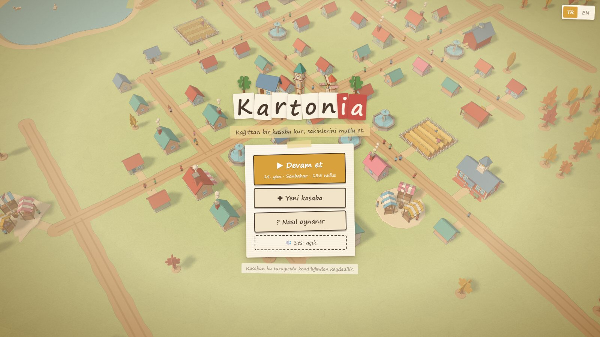
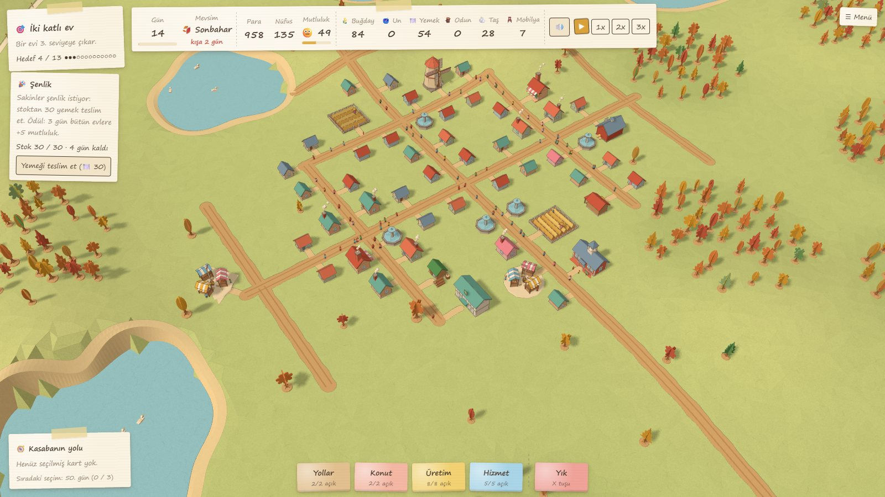
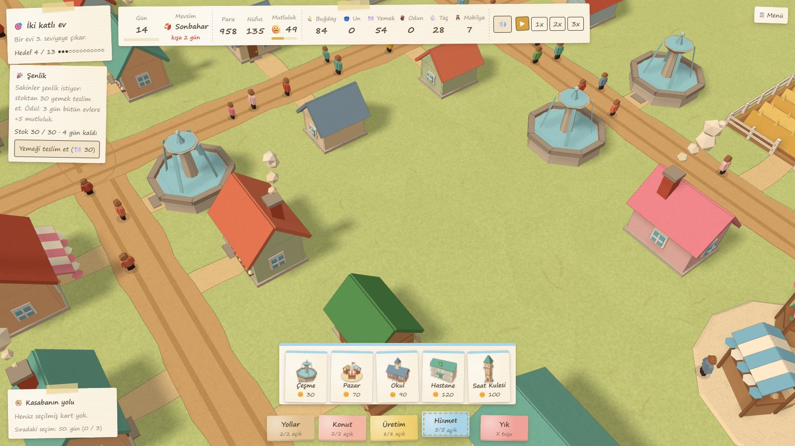
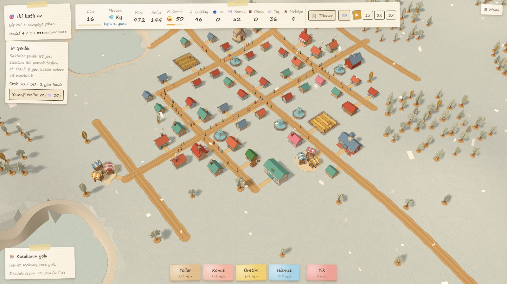
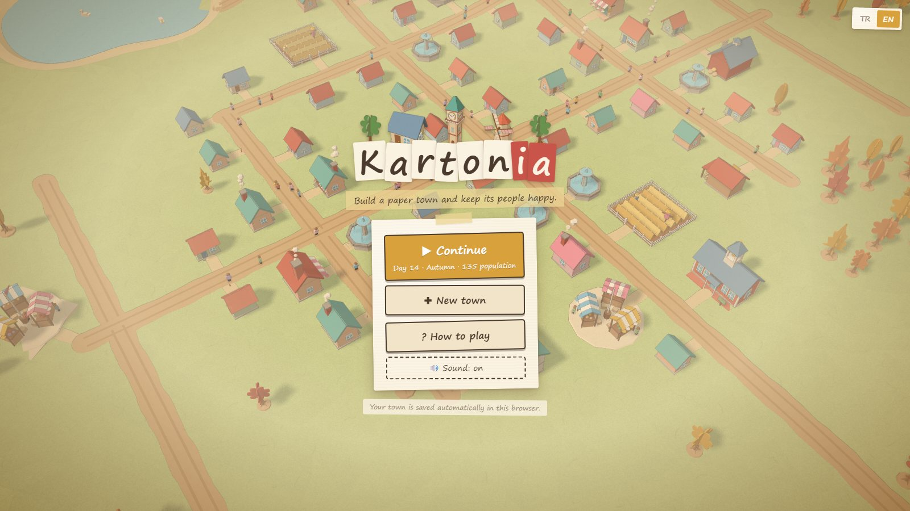

# Kartonia

**Kağıttan bir kasaba kur, sakinlerini mutlu et.**

Kartonia, her şeyin kağıttan katlanmış bir maket gibi göründüğü, sakin bir 3D kasaba kurma oyunu. Tarayıcıda oynanır, kurulum gerektirmez. Türkçe ve İngilizce.

### ▶ [Hemen oyna: mevocan.github.io/kartonia](https://mevocan.github.io/kartonia/)



*A calm 3D town-building game where everything looks like a papercraft model. Plays in the browser, no install. Available in Turkish and English.*

## Oyun

Yuvarlak bir karton arazinin üstüne, ızgara olmadan, dilediğin yere yollar çizer ve binalar kurarsın. Sakinler evlere yerleşir, her gün sonunda vergi öder; vergiyle kasaba büyür. Ama evler kendiliğinden büyümez: su, yemek, odun, okul ve sağlık ister. İhtiyaçları karşılanan ev bir üst seviyeye çıkar, karşılanmayan küçülür.



- **Serbest yerleşim:** Yolları fareyle sürükleyerek çizersin, binalar yol kenarına kurulur ve önlerini kendiliğinden yola çevirir. Bina konduğunda kağıt maket gibi parça parça katlanarak yükselir.
- **Büyüyen evler:** Kulübe, ev ve iki katlı ev. Her seviye daha çok sakin ve daha çok ihtiyaç demek.
- **Üretim zinciri:** Tarla buğday üretir, değirmen una çevirir, fırın ekmek pişirir. Oduncu, taş ocağı, marangoz, balıkçı ve ambar da var. Binaların yeri önemli: göl kenarındaki tarla daha bereketli, tepedeki değirmen daha hızlı döner.
- **Yaşayan kasaba:** Yollarda yürüyen kağıt insanlar, bacalardan tüten duman, göllerde ördekler, gökyüzünde kuşlar.
- **Mevsimler:** İlkbahar, yaz, sonbahar ve kış. Kışın tarlalar ürün vermez, evler daha çok odun yakar. Sonbaharda kışa hazırlanmak gerekir.
- **Gezgin tüccar:** Ara sıra kasabaya gelir, birkaç gün kalır; fazla malını satar, eksiğini alırsın.
- **Sakin istekleri ve hedefler:** Sakinler şenlik ya da ağaçlandırma ister. Sıradaki hedef yeni binaları açar. En büyük hedef, malzemeyle dört aşamada yükselen Saat Kulesi.
- **Kasabanın karakteri:** Belirli günlerde üç karar kartından birini seçersin. Her kartın bir artısı ve bir eksisi var, seçim kalıcıdır.





Dikkat: kasa üç gün üst üste −50'nin altında kalırsa kasaba iflas eder.

## Nasıl oynanır

| Kontrol | Ne yapar |
|---|---|
| Sol tık | Seçili binayı koy / binayı seç |
| Sol sürükle, WASD | Haritada gez (yol aracında yol çizer) |
| Sağ sürükle | Kamerayı döndür |
| Tekerlek | Yakınlaş / uzaklaş |
| Q / E | Binayı döndür |
| X | Yıkma aracı |
| Esc, sağ tık | Seçimi bırak |
| Boşluk, 1 / 2 / 3 | Duraklat, hız |

İlk oyunda kısa bir öğretici yol gösterir. Fare ve klavye için tasarlandı; en iyi bilgisayar tarayıcısında oynanır. Kasaba tarayıcıda kendiliğinden kaydedilir.

<details>
<summary>English title screen</summary>



</details>

## Geliştirme

[Node.js](https://nodejs.org) 20.19+ ya da 22.12+ gerekir.

```sh
npm install
npm run dev        # geliştirme sunucusu
npm test           # birim testleri (Vitest)
npm run build      # tip kontrolü + dist/ klasörüne üretim derlemesi
npm run preview    # derlenmiş sürümü yerelde aç
```

Vite, TypeScript ve Three.js ile yazıldı; başka bağımlılık yok. Bütün modeller, dokular ve sesler kodla üretilir; projede görsel ya da ses dosyası yoktur.

| Klasör | İçerik |
|---|---|
| `src/logic/` | Oyun kuralları: saf TypeScript, birim testli |
| `src/render/` | Three.js çizimi, kağıt modeller, animasyonlar |
| `src/ui/` | Arayüz (HUD, menüler, giriş ekranı) |
| `src/audio/` | Web Audio ile üretilen efektler ve müzik |
| `src/lang/` | Dil dosyaları (`tr.json`, `en.json`) |

Kurallar ve mimarinin ayrıntısı [CLAUDE.md](CLAUDE.md) dosyasında.

### Yeni dil eklemek

1. `src/lang/en.json` dosyasını `src/lang/<kod>.json` olarak kopyalayıp çevir.
2. `src/ui/i18n.ts` içindeki `Dil` tipine ve `DILLER` listesine kodu ekle.
3. `npm test` çalıştır: eksik ya da fazla anahtar varsa test gösterir.

### Yayın

`main` dalına her push'ta GitHub Actions ([deploy.yml](.github/workflows/deploy.yml)) testleri çalıştırır, oyunu derler ve GitHub Pages'te yayınlar.
